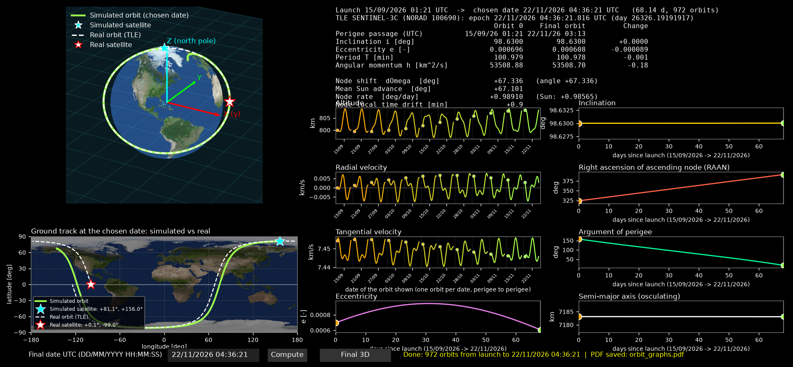
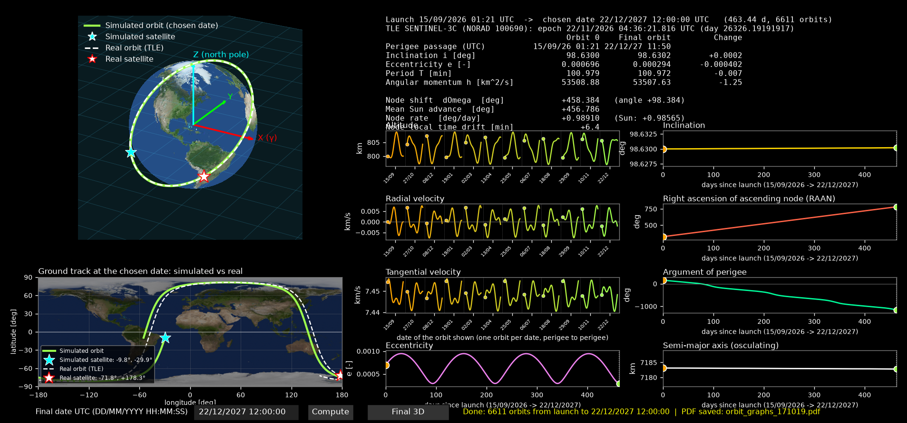

# orbit-sim

A Python tool for **mission-analysis style studies of a LEO satellite under the J2 perturbation**:
propagate from the launch date to any date, check the orbit against the **real TLE** of the satellite,
and verify whether it is **sun-synchronous**. The worked example is **Sentinel-3C**
(Vega-C VV30, 15/09/2026 01:21 UTC).  

The code is easily applicable for every kind of orbit and allows the simulation of it in time, with the correct TLE.



> **Status:** personal engineering project. It is a simplified model, not an operational tool
> (see [Limitations](#limitations)).

## What it does

- Propagates the orbit with **J2** (DOP853, rtol 1e-10) from a launch date/time to a final
  date/time typed in the box (`DD/MM/YYYY HH:MM:SS`, UTC).
- Draws the launch orbit and the orbit at the chosen date in 3D (rotating Earth, ΔΩ and Δω marked),
  the ground track on a map and the evolution of e, i, RAAN, ω and a.
- **Sun-synchronous check:** compares the node drift ΔΩ with the motion of the mean Sun
  (0.98565°/day) and states the verdict, with the drift of the local solar time of the node.
- **Real orbit overlay:** reads a TLE, propagates it (mean elements + secular J2) and draws the real
  orbit and the real satellite position next to the simulated ones, with the distance between them.
- **A4 PDF report**, rewritten at every computation: ground track over the full width, then the
  2D graphs and a table with the position (ECI X/Y/Z, latitude, longitude, altitude) of the
  simulated and of the real satellite.
- `fit_tle.py` fits altitude, start phase and RAAN of the simulation to a TLE.
- `astro_utils.py`: tested analytical toolkit (plane-change Δv, Hohmann with plane change,
  Gauss equations, local time of the node, TLE parsing). Is't used in this partuicular simulation

## Install and run

Python 3.10+.

```bash
python -m venv .venv
.venv\Scripts\activate          # Windows   (Linux/macOS: source .venv/bin/activate)
pip install -r requirements.txt
python orbit_static.py
```

Orbit, launch date and TLE are parameters at the top of `orbit_static.py`. The TLE epoch can be written as a readable date (`TLE_EPOCH = "DD/MM/YYYY HH:MM:SS"`): the program converts it to the TLE format and rewrites the epoch in line 1, checksum included. To use another
satellite, paste its TLE in `TLE_LINE1` / `TLE_LINE2`, set `LAUNCH`, run `python fit_tle.py` and copy
the printed block into the parameters. An Earth map `terra.jpg` (equirectangular, 2:1) next to the
script gives a textured Earth; without it a plain sphere is used.

## Physics

Acceleration with J2 (ECI, `mu = 398600.4418 km³/s²`, `R = 6378.137 km`, `J2 = 1.08262668e-3`):

```
a = -mu r/r³ - (3/2) J2 mu R²/r⁵ · [ x(1-5z²/r²), y(1-5z²/r²), z(3-5z²/r²) ]
```

Earth orientation from GMST (Meeus, *Astronomical Algorithms*, eq. 12.4).
Local solar time of the node: `LTAN = 12 h + (RAAN − RA_sun)/15`, `LTDN = LTAN + 12 h`.
The derivations (J2, J3/J4, tesseral harmonics, local time ↔ RAAN, 3D Δv) are in [`docs/`](docs)
(written in Italian).

## Validation

| Check | Result|
Chosen TLE 22/11/2026 04:36:21

 Node regression, simulation vs first-order J2 theory (Sentinel-3C orbit) |  +67.336 °  vs 67.101 °(0.35 % of error) |
| Node rate vs Sun | +0.98910 deg/day vs +0.98565 (sun-synchronous verdict, drift of the local time +0.21 min in 67 days) |
|The simulation propagets very optimisticaly as it is much distant from the chosen TLE date, as in the image bellow,  with the chosen date on: 22/12/2027 12:00:00 UTC|


How to read this:

- The fit uses three parameters (altitude, start phase, RAAN) against three quantities of one TLE, so
  the 5 km agreement is a consistency check, **not** an independent validation. The independent one
  is the RAAN row; a true validation of position needs a second TLE of another date.
- The "real" position away from the TLE epoch is the TLE mean elements propagated with J2, i.e. a
  model similar to the simulation itself.

## Limitations

- Only J2 in the integrator. J3, J4 and tesseral harmonics are derived in `docs/` and checked
  numerically, but not in the code yet; no drag, no third bodies, no solar radiation pressure.
- The real satellite is propagated with mean elements and secular J2, not with SGP4: a few km near the
  epoch, worse further away. No manoeuvres are modelled.
- For a nearly circular orbit (e ≈ 7·10⁻⁴) the osculating perigee is not defined: orbits are counted
  
- Simulation start is a reference point fitted to the TLE, not the real launch site.
- Time: UT1 ≈ UTC, mean Sun; no equation of time.

## Tests

```bash
pip install -r requirements-dev.txt
python -m pytest -q tests
```

## Possible next steps

- [ ] Separation and relative motion of two payloads of a dual launch (Sentinel-3C / FLEX, Vega-C VV30)
- [ ] Collision-avoidance screening: minimum distance between two objects over the first orbits
- [ ] Sensitivity analysis / Monte Carlo on injection errors (a, i, phase) → effect on LTDN and ground track
- [ ] Trajectory optimisation (multi-burn transfers with `scipy.optimize`)
- [ ] SGP4 for the real orbit; J3, J4 and (2,2) in the integrator
- [ ] English version of the documents

## Repository

```
orbit_static.py     main application (simulation, plots, PDF report)
fit_tle.py          fit the simulation to a TLE
astro_utils.py      analytical toolkit
tests/              pytest tests for astro_utils
docs/               screenshots, example report, derivations (PDF, Italian)
```

## Development and AI assistance

I designed the project and chose the models and the validation approach. The code, the
derivations in `docs/` and the tests were developed with the help of an AI assistant
(Claude, by Anthropic); I reviewed and ran everything and I take responsibility for the content.
The numerical checks in the Validation section can be reproduced with the code in this repository.

## License

MIT, see [LICENSE](LICENSE).
